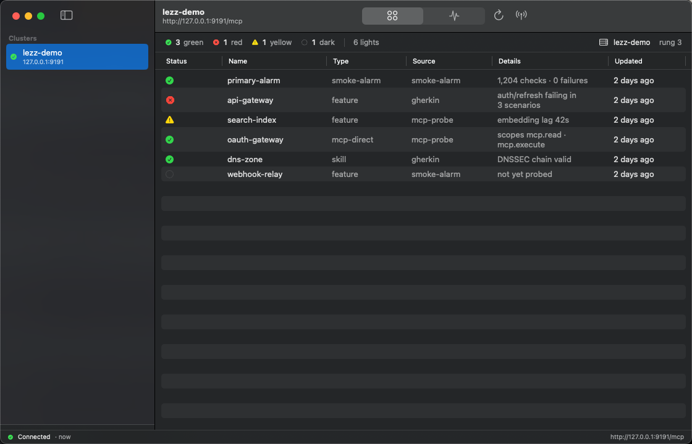
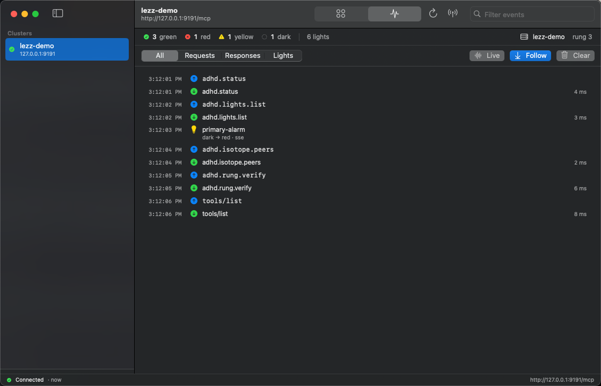
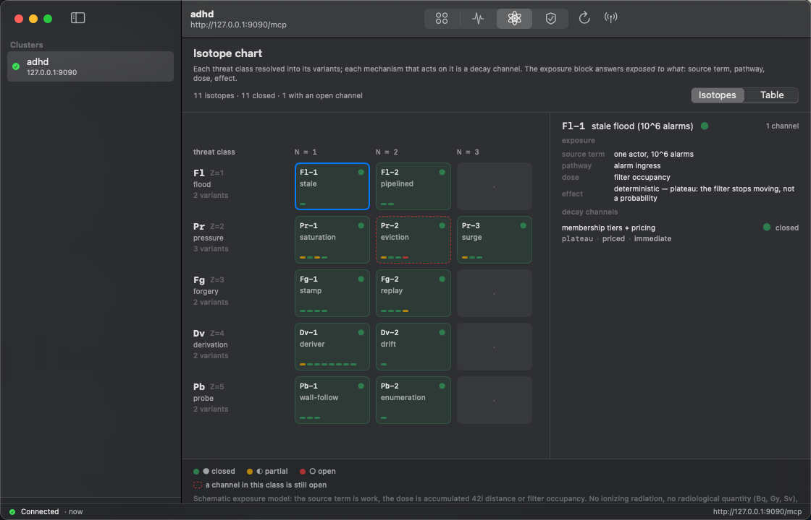
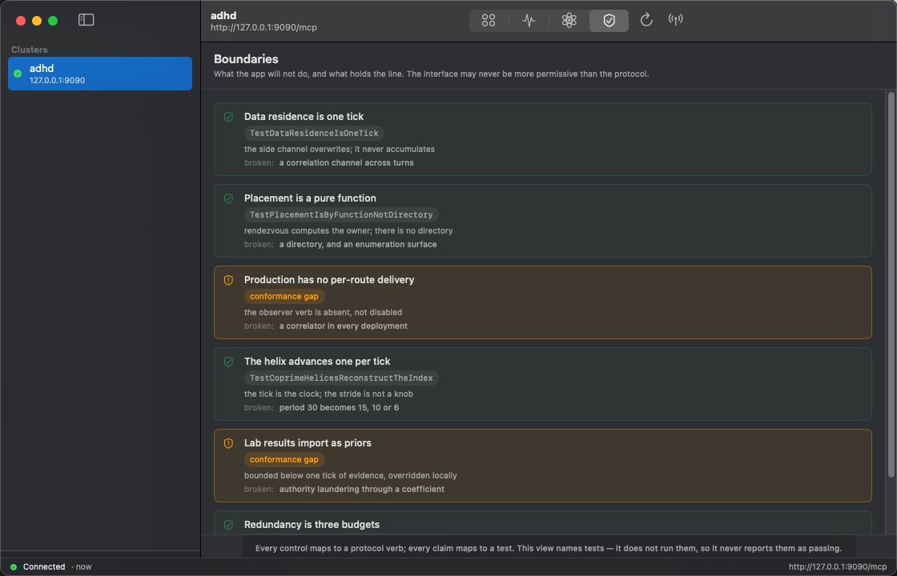
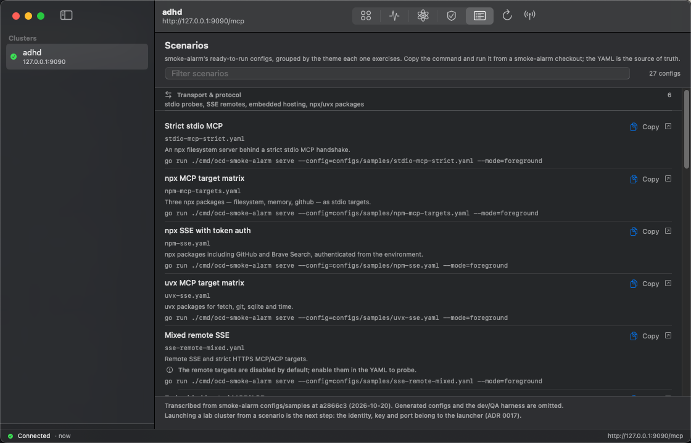

# lezz.sea

A small macOS app for watching an [adhd](https://github.com/james-gibson/adhd)
cluster — the lights it reports and the MCP traffic it logs, live — and for
reading the [smoke-alarm](https://github.com/james-gibson/smoke-alarm) scenarios
that cluster's lab can run.











## What it does

- **Lights.** Reads `adhd.lights.list` and `adhd.status` from the selected
  cluster on a configurable interval. Green / red / yellow / dark, with the
  instance name and its 42i trust rung.
- **Events.** Follows adhd's JSONL MCP traffic log — one row per request,
  response, and light update, filterable and searchable, with the raw line on
  the context menu.
- **Isotopes.** smoke-alarm's threat × mechanism matrix as a chart of the
  nuclides: each threat class resolved into its variants, every mechanism a
  decay channel with a daughter state, and every isotope carrying its exposure
  fields — source term, pathway, dose, deterministic or stochastic effect.
  Toggles to the plain grid. Needs no cluster. See
  `smoke-alarm/docs/adr/0012-the-isotope-view-is-the-chart-of-the-nuclides.md`.
- **Boundaries.** The invariants the rest of the app depends on, each with the
  test that holds it and the failure it prevents. Two rows are conformance
  gaps and are shown as debt, not as passes. Static, and needs no cluster.
  See `smoke-alarm/docs/adr/0020-the-boundary-is-the-interface.md`.
- **Scenarios.** smoke-alarm's ready-to-run config catalog, grouped by theme —
  transport, federation, warroom, auth, deployment, discovery — with the
  documented command for each config and a link to the YAML. Static, and needs
  no cluster. Selecting a scenario is the step before launching one; identity,
  key and port belong to the launcher (ADR 0017).
- **Discovery.** Checks the lezz cluster registry (`:19100/cluster`), probes the
  default adhd endpoint (`127.0.0.1:9090/mcp`), and watches Bonjour for
  `_adhd-isotope._tcp`.
- **Drop targets.** Drop a `.jsonl` log to stream it. Drop a `.yaml` / `.json`
  config (an `mcp_server.addr`, or any URL ending `/mcp`) to add its cluster.
- **Standard macOS chrome.** Menu commands, a Settings window, a search field,
  a status bar, and the usual keyboard shortcuts. The panel switch lives in the
  toolbar, so no control floats over the content.

## Build

macOS 14 or later, Xcode 16.

```sh
open LezzSea.xcodeproj
```

or from the command line:

```sh
xcodebuild -project LezzSea.xcodeproj -scheme LezzSea \
  -configuration Debug -destination 'platform=macOS' build
```

Run the unit and UI tests with:

```sh
xcodebuild -project LezzSea.xcodeproj -scheme LezzSea \
  -destination 'platform=macOS' test
```

The UI tests assert the two properties the shipped build broke: the window
never shrinks below its floor, and the panel switch moves between panes. They
also check that the lights table's rightmost column stays inside the window,
that the isotope chart and boundary list render without a cluster, and that the
scenario filter narrows the catalog.

## Accessibility

The app is built to pass an Accessibility Inspector audit rather than to look
accessible in a screenshot.

- **Status is never colour alone.** Green is a tick, red a stop sign, yellow a
  warning triangle, dark a dotted ring. The same shapes appear in the summary
  bar and the table, so the display survives colour blindness, Differentiate
  Without Colour, Increase Contrast, and greyscale.
- **Every control is named.** Toolbar buttons, the panel switch, the filter
  segments, the pause and follow toggles, the status counts, cluster rows, and
  each event row carry explicit labels. Decorative symbols are hidden from the
  accessibility tree.
- **The static panels are readable too.** Each isotope cell is a button with
  its name, verdict, and channel count; each matrix cell names its mechanism and
  verdict; each boundary row reads as one sentence, including the test that
  holds it or the fact that it is a conformance gap. Each scenario row names
  its config and its command, and the Copy button says which scenario it copies.
- **Chart and boundary layouts flex.** The isotope chart scrolls inside its
  pane rather than demanding a fixed 720 points, and boundary rows move the
  evidence chip below the invariant when the pane is narrow.
- **State changes are spoken.** Connection changes, toasts, and a rejected
  endpoint are announced through VoiceOver instead of appearing only as pixels.
- **Reduce Motion is honoured.** The event list and the toast stop animating
  when the system setting is on.
- **The window has a floor.** 760 × 500 points. The summary bar drops its
  secondary detail instead of colliding with itself, and the lights table
  switches from six columns to four when the detail pane is narrow. See
  `LayoutMetrics` in `LezzSea/Support/Presentation.swift`.

## App Store readiness

- **App Sandbox is on**, with `com.apple.security.network.client` (the adhd
  endpoint, the registry, and Bonjour) and
  `com.apple.security.files.user-selected.read-only` (the traffic log).
- **The log choice survives relaunch.** Picking a log stores a
  security-scoped bookmark; the next launch resolves it and starts the scope
  before tailing the file. "Use Default Log" falls back to the open panel when
  the default path is outside the sandbox's reach.
- **Local network usage is declared** with `NSLocalNetworkUsageDescription` and
  `NSBonjourServices`, so the macOS 15 local-network prompt explains itself.
- **A privacy manifest** (`PrivacyInfo.xcprivacy`) declares the only
  required-reason API the app touches — UserDefaults, reason `CA92.1` — and
  states that nothing is tracked or collected.
- `ITSAppUsesNonExemptEncryption` is `false`: the app implements no
  cryptography, it only speaks HTTP/JSON to a cluster the user selected.

See [docs/app-store.md](docs/app-store.md) for the review checklist and the
items that can only be completed in App Store Connect.

## Publish a dev build

Builds are signed on the signing machine and published to the `dev` prerelease;
CI has no certificate and only verifies what was published.

```sh
scripts/publish-dev.sh              # add --notarize once credentials are stored
```

Stable download:

```
https://github.com/james-gibson/lezz.sea/releases/download/dev/lezz.sea.app.zip
```

See [docs/publishing.md](docs/publishing.md) for what a publish produces, why it
archives and exports rather than builds, and what CI verifies.

## Using it

| Action | Shortcut |
| --- | --- |
| Add a cluster | ⌘N |
| Open an adhd log | ⌘O |
| Refresh lights | ⌘R |
| Discover clusters | ⇧⌘R |
| Lights tab | ⌘1 |
| Events tab | ⌘2 |
| Isotopes tab | ⌘3 |
| Boundaries tab | ⌘4 |
| Scenarios tab | ⌘5 |
| Pause the event stream | ⇧⌘P |
| Clear events | ⌘K |
| Settings | ⌘, |

The event stream defaults to `~/Library/Logs/kb-adhd.jsonl`, the idle launchd
agent's log (`scripts/adhd` in the vault). Use **File ▸ Open adhd Log…** or the
Settings window to follow another instance's log — `spin.sh` instances write
`~/Library/Logs/kb-adhd-<name>.jsonl`. Under the sandbox the first choice grants
access to that file; subsequent launches reuse the stored bookmark.

## Notes on the design

- **Two MCP calls, no SDK.** adhd answers `adhd.status` and
  `adhd.lights.list` directly as JSON-RPC methods, so the client is a small
  `URLSession` wrapper instead of an MCP transport.
- **The log is the live channel.** adhd's `/mcp` SSE stream carries server
  frames only; the JSONL log is where every request and response actually
  appears. Watching it is the honest live view.
- **The isotope chart is static and pure.** `NuclideChart` is data plus
  arithmetic, `NuclideChartView` is SwiftUI over it — no `AppModel`, no
  network, no files, and no cluster. That is why it renders in the empty state
  and why it would drop into a WidgetKit extension unchanged.
- **The isotope chart is an exposure model.** The dosimetry vocabulary is
  tracked rather than avoided — source term, pathway, dose, and deterministic
  versus stochastic effect — with work as the source and accumulated 42i
  distance as the dose. No ionizing radiation, no radiological quantity
  (Bq, Gy, Sv), no safety function.
- **The scenario catalog is a suggestion surface, not a launcher.** It is
  transcribed from `smoke-alarm/configs/samples` at a recorded commit, because
  the YAML is the source of truth. The app copies the documented `go run`
  command and links to the file; it does not start a process. A launcher has to
  mint an identity, provision a key and choose a port (ADR 0017), and a viewer
  should not pretend to do that.
- **The panel is not a `TabView`.** On macOS a `TabView` with `.tabItem` draws
  its own strip over the content, which overlapped the summary bar. The panel is
  a toolbar picker bound to `AppModel.tab` and the detail pane switches in
  place.
- **The table adapts by column, not by clipping.** `Table` pins columns at
  their ideal widths, so a six-column table cannot fit the detail pane at the
  window's floor. The view measures its width and renders a four-column table
  there instead of letting the Updated column fall off the right edge.
- **No third-party dependencies.**

## Layout

```
LezzSea/
  LezzSeaApp.swift          App, Window, Settings scenes
  AppModel.swift            selection, polling, discovery, log tail
  Models/CoreModels.swift   lights, status, clusters, traffic events
  Models/NuclideChart.swift threat classes, isotopes, decay channels
  Models/Boundaries.swift   invariants, the test that holds each, its failure
  Models/Scenarios.swift    smoke-alarm's sample configs, grouped by theme
  Services/                 JSON-RPC client, file tail, Bonjour, URL normalising
  Support/                  status naming, layout metrics, VoiceOver announcements
  Views/                    sidebar, dashboard, lights, events, isotopes, boundaries, scenarios, settings
  LezzSea.entitlements      App Sandbox, network client, user-selected read
  PrivacyInfo.xcprivacy     required-reason API declarations
```

The measure behind the rung and the light colours is described in the vault:
`scripts/lab/PLANE.md`, `scripts/lab/MATH.md`, and `scripts/lab/SPLASH.md`.
